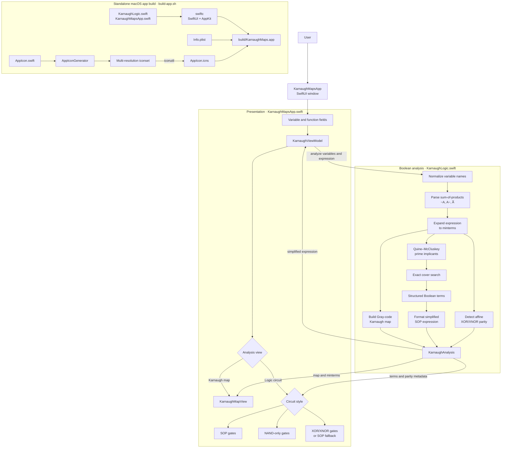

# Architecture

Karnaugh Maps is a native macOS app for entering Boolean functions with up to five variables, viewing their Karnaugh maps, and exploring simplified logic circuits. It is organized into a SwiftUI presentation layer and a Foundation-based Boolean analysis engine, with the build script assembling both into a standalone `.app` bundle.

The diagram traces the flow from user input through parsing and analysis to the map and circuit views. It also shows how the circuit styles share the same minimized result, and how the icon and app bundle are generated independently at build time.

The app is compiled directly with the Swift compiler and macOS SDK; no Xcode project or XCTest target is required. Generated app bundles, icon assets, and intermediate binaries are kept under the ignored `build/` directory.
