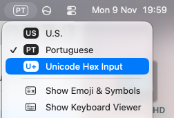

# Karnaugh Maps

A native macOS SwiftUI app that creates Karnaugh maps and minimum sum-of-products expressions for Boolean functions with one to five variables.

## Build and run

Requirements: macOS 27 and the Swift compiler included with the macOS Command Line Tools.

```sh
./build-app.sh
open build/KarnaughMaps.app
```

The script compiles the Swift sources directly into an `.app` bundle and generates a custom multi-resolution app icon featuring a dimensional logic gate. It does not require an Xcode project, Xcode, or XCTest.

## Expression syntax

- Enter one to five unique, single-letter variables in the variable field. They are always capitalized, and their order defines the minterm bit order.
- Use `+` for OR and adjacent variables (or `·`) for AND.
- Negate a variable in the expression with `~A`, `A~`, or a combining overline: `A̅`. The variable list itself should contain only uncomplemented variable names.
- An output assignment such as `Y = ...` is optional. The constants `0` and `1` are supported.

For example, with variables `A, B, C, D`, the function `Y = A~B~C~D~ + A~B~C~D` produces minterms 0 and 1 and simplifies to `~A · ~B · ~C`.

### Enable and use Unicode Hex Input in Finder

1. Build the app from the project folder with `./build-app.sh`.
2. Open the project folder in Finder, then open `build` and double-click `KarnaughMaps.app`.
3. Open **Apple menu → System Settings → Keyboard**. In the **Text Input** section, click **Edit…** next to **Input Sources**.
4. Click **+**, choose **Others**, select **Unicode Hex Input**, then click **Add**.
5. In the same Input Sources settings, enable **Show Input menu in menu bar** if the input menu is not already visible.
6. In the menu bar, open the input menu and select **Unicode Hex Input**. Return to the app and click in the **Boolean expression** editor.
7. Type the variable, for example `A`. Immediately after it, hold **Option**, type `0305`, then release **Option**. The result is `A̅`. Repeat for each complemented variable.

The menu-bar input menu should look like this when **Unicode Hex Input** is selected:



The combining overline belongs in the Boolean expression, not in the variable list. You can switch back to your usual keyboard from the same menu bar input menu when finished.

The map uses a clean, ruled-grid layout with complemented-variable overbars and Gray-code row and column assignments, splitting variables between the two axes. Switch between the Karnaugh map and the gate-level circuit using the segmented view selector. The circuit offers three styles:

- **SOP** shows the minimized sum-of-products using NOT, AND, and OR gates.
- **NAND-only** converts that same minimized expression into an equivalent network of NAND gates. Tied NAND inputs provide inversions.
- **XOR-aware** detects affine parity functions and displays an XOR/XNOR gate when possible; other functions fall back to the equivalent SOP drawing.

Simplification uses Quine–McCluskey prime implicants and an exact cover search.
